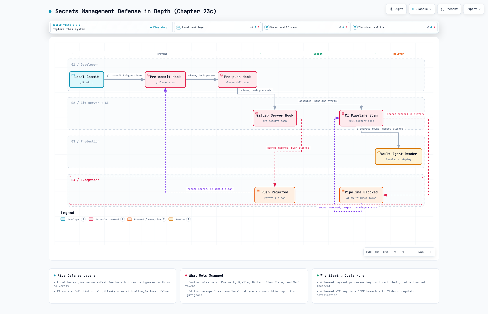

<div align="center">

<a href="../README.md"></a>

# Chapter 23c: Secrets Management and Git Hygiene for iGaming Engineering

**📙 Part of Volume 3 — Security Engineering and Runtime Defense** · €84.90

[The Backend of Luck](../README.md) · [Buy this volume on Amazon](https://www.amazon.com/dp/B0GZCRSTMH) · [PDF and EPUB](https://leanpub.com/the-backend-of-luck) · [Chapter map](../README.md#chapter-map)

</div>

---

> Companion code for Chapter 23c of *The Backend of Luck*. The chapter itself
> explains the why and the trade-offs; the files here are what you run.
> Example operator throughout the series is the fictional **AcmeToCasino**.

---

## Architecture diagram

<div align="center">
<a href="https://thebackendofluck.com/architecture/ch23c-secrets-management-git-hygiene.html"></a>

<sub><em>Secrets Management Defense in Depth. <a href="https://thebackendofluck.com/architecture/ch23c-secrets-management-git-hygiene.html">Open the interactive version</a>: pan, zoom, guided views, light/dark theme, export.</em></sub>
</div>

---

## Commit and Tag Signing with SSH and GPG

Everything else in this chapter protects the secrets that live near your code. This section protects something more basic: the record of who wrote the code. In a regulated shop that record is evidence, and by default git does nothing to make it trustworthy.

### Why It Matters: Git Identity Is Just a Config Value

The author name and email on a commit come from two local settings. Nothing checks them:

```bash
git config user.name  "Lead RNG Engineer"
git config user.email "rng-lead@acmetocasino.com"
git commit -m "fix: rebalance reel strip weights"
```

That commit now carries the RNG lead's name. Push it to GitHub and it even shows their avatar, because GitHub matches the email to an account. Anyone with write access, or anyone holding a stolen token with write access, can do the same thing.

In most software companies that is an annoyance. In iGaming it lands on four things you care about:

- **Audit evidence.** Certification labs (GLI, BMM, eCOGRA) certify a specific build of your RNG and game math. When the regulator later asks who changed a certified component between two submissions, a `git log` full of names is a claim. A log full of verified signatures, each tied to a key your organization issued to one person, is evidence.
- **Change control on regulated code.** Your change management process (Chapter 23 covers CODEOWNERS and two-person review) says the RNG, the wallet ledger and the payout tables only change with named approvals. Review approvals are bound to GitHub accounts, but the commits under review are not. Without signatures, an approved PR can contain commits attributed to someone who never wrote them.
- **Supply chain and stolen credentials.** Section 9 assumes a leaked GitHub or GitLab token will be used before you rotate it. With required signatures on `main`, a token alone is not enough to land code. The attacker also needs a private signing key, and if that key lives on a hardware token, they need the token in hand and a finger to touch it.
- **Insider risk.** A developer who pushes a change under a colleague's name is hard to catch after the fact. Signing turns impersonation from trivial into something that requires stealing a colleague's key.

Be clear about what a signature does not prove. It proves that someone holding the key signed the commit. It does not prove the code is safe, and it does not help if the developer's laptop is compromised while the key sits unlocked in an agent. That is why I push teams toward hardware-backed keys, covered below.

### SSH Signing: The Default I Recommend

Git has supported SSH signatures since 2.34. For most teams this is the right starting point: every developer already has `ssh-keygen`, there is no keyring or trust model to learn, and the same YubiKeys you issue for authentication (Chapter 24) can hold the signing key.

I use a dedicated signing key rather than reusing the authentication key. GitHub lets you upload the same key for both, but separate keys let you rotate one without touching the other, and a key that only signs is easier to reason about in an audit.

```bash
# 1. Generate a dedicated signing key
ssh-keygen -t ed25519 -C "alice@acmetocasino.com" -f ~/.ssh/id_ed25519_signing

# 2. Tell git to sign with SSH, using that key, for every commit and tag
git config --global gpg.format ssh
git config --global user.signingkey ~/.ssh/id_ed25519_signing.pub
git config --global commit.gpgsign true
git config --global tag.gpgsign true

# 3. When user.signingkey points at the .pub file, the private key must be in ssh-agent
ssh-add ~/.ssh/id_ed25519_signing
```

`user.signingkey` can point at the private key file instead, or hold the public key inline with a `key::` prefix. Pointing at the `.pub` file and loading the private key into the agent is the setup that works the same way for file keys and hardware keys, so it is the one I standardize on.

Then register the public key on GitHub **as a Signing Key**. This is the step people miss. GitHub keeps authentication keys and signing keys in separate lists under *Settings → SSH and GPG keys*, and a key added only as an authentication key will not mark your commits as verified.

```bash
# gh needs the admin:ssh_signing_key scope once
gh auth refresh -h github.com -s admin:ssh_signing_key
gh ssh-key add ~/.ssh/id_ed25519_signing.pub --type signing --title "alice laptop 2026"
```

#### Verifying SSH Signatures Locally: `allowed_signers`

SSH has no web of trust. Git only treats an SSH signature as trusted if the public key appears in a file you point it at with `gpg.ssh.allowedSignersFile`. Without that file, `git verify-commit` fails even on a perfectly good signature.

The format is one line per key: the principal (the committer email), optional restrictions, then the public key.

```text
# ~/.config/git/allowed_signers
alice@acmetocasino.com namespaces="git" ssh-ed25519 AAAAC3NzaC1lZDI1NTE5AAAA... alice-laptop
bob@acmetocasino.com namespaces="git" sk-ssh-ed25519@openssh.com AAAAGnNrLXNzaC1lZDI1NTE5... bob-yubikey
```

```bash
git config --global gpg.ssh.allowedSignersFile ~/.config/git/allowed_signers
```

For a regulated repository I go one step further and commit the file to the repository itself, for example at `.github/allowed_signers`, owned in CODEOWNERS by the security team. Git accepts a path relative to the top of the working tree, so every clone verifies against the same list. Adding a new engineer's key then becomes a reviewed, signed change with its own audit trail, which is exactly the kind of artifact a certification lab likes to see. Since OpenSSH 8.8 each line can also carry `valid-after` and `valid-before` options, which lets you retire a key without invalidating the signatures it made while it was valid.

#### Hardware-Backed SSH Keys

A key file on disk can be copied by malware. A key generated on a FIDO2 token cannot leave the token, and every signature needs a physical touch. Chapter 24 issues every engineer a YubiKey 5C NFC; the same device generates the signing key:

```bash
# Requires the YubiKey inserted; touch it when prompted
ssh-keygen -t ed25519-sk -C "alice@acmetocasino.com" -f ~/.ssh/id_ed25519_sk_signing
```

If the token does not support Ed25519, `ssh-keygen` reports `invalid format` or `feature not supported`; use `-t ecdsa-sk` instead. The rest of the setup is identical: point `user.signingkey` at the `.pub` file, add it to the agent, upload it to GitHub as a signing key. From then on every commit blinks the YubiKey and waits for a touch, which is a small cost for knowing that a stolen laptop image cannot sign anything.

Do not confuse this with the YubiHSM 2 from Chapter 20. The HSM holds platform keys: RNG seed signing, round outcome endorsement, the CA. Developer signing keys belong on personal tokens, one per person, so a signature identifies an individual.

### GPG Signing

GPG is the older path and still the right one if your team already runs OpenPGP keys, for example on the YubiKey OpenPGP applet as described in Chapter 24 ("YubiKey + GitHub Integration", Step 3). It gives you real expiry dates and revocation certificates, at the cost of more moving parts.

```bash
# Generate a key: choose ECC (Ed25519) or RSA 4096, set an expiry of 1-2 years,
# and use the same email you commit with
gpg --full-generate-key

# Find the long key ID
gpg --list-secret-keys --keyid-format=long
# sec   ed25519/3AA5C34371567BD2 2026-11-20 [SC] [expires: 2028-11-19]

# Configure git (gpg.format defaults to openpgp; unset it if you tried SSH first)
git config --global --unset gpg.format
git config --global user.signingkey 3AA5C34371567BD2
git config --global commit.gpgsign true
git config --global tag.gpgsign true

# Upload the public key to GitHub (Settings → SSH and GPG keys → New GPG key, or gh)
gpg --armor --export 3AA5C34371567BD2 > alice-signing.asc
gh gpg-key add alice-signing.asc
```

Most "gpg failed to sign the data" errors come from gpg-agent not being able to ask for the passphrase. On a terminal, export `GPG_TTY=$(tty)` in your shell profile. On macOS, install a GUI pinentry so IDEs and git clients can prompt too:

```bash
brew install pinentry-mac
echo "pinentry-program $(brew --prefix)/bin/pinentry-mac" >> ~/.gnupg/gpg-agent.conf
gpgconf --kill gpg-agent
```

Treat expiry as a feature. A key that expires forces a yearly check that the person still works here and the key still lives where you think it does. Extending it is one command, followed by re-uploading the public key so GitHub sees the new date:

```bash
gpg --quick-set-expire <FINGERPRINT> 1y
```

Generate a revocation certificate the day you create the key (`gpg --output alice-revoke.asc --gen-revoke 3AA5C34371567BD2`) and store it offline. If a signing key is lost or a laptop is stolen, handle it like any other credential in Section 9: revoke, remove the key from GitHub and from every `allowed_signers` or keyring that trusts it, issue a new one, and record the exposure window in the incident timeline. For SSH keys there is no revocation certificate; removal from GitHub plus a `valid-before` date in `allowed_signers` does the same job.

### Verifying Signatures

On the command line:

```bash
# Full signature output for recent commits
git log --show-signature -5

# One line per commit: %G? is the status, %GS the signer
git log --format='%h %G? %GS %s' -20

# Exit non-zero if the commit or tag is not validly signed
git verify-commit HEAD
git verify-tag v3.4.0
```

The `%G?` codes worth knowing: `G` good, `U` good signature with unknown trust, `B` bad, `E` cannot be checked (usually a missing public key), `N` not signed. You will see `E` on merge and squash commits created by GitHub until you import its web-flow key:

```bash
curl -fsSL https://github.com/web-flow.gpg | gpg --import
```

On GitHub, a commit signed with a key registered on the author's account shows a **Verified** badge. Commits that are not signed show nothing, which makes them easy to miss. Turn on **vigilant mode** for every engineer (*Settings → SSH and GPG keys → Flag unsigned commits as unverified*): from then on, anything unsigned that claims to be theirs is labeled **Unverified**, and a commit signed by someone else but naming them as author shows as **Partially verified**. Only enable it once the engineer signs everything, or their own history fills with warnings.

For releases, sign the tag that marks the build you send to the certification lab:

```bash
git tag -s v3.4.0-gli -m "Build submitted to GLI for RNG recertification"
git push origin v3.4.0-gli
```

The tag signature links the exact commit the lab tested to a named engineer, and `git verify-tag` lets an auditor confirm it years later.

### Enforcement: Require Signed Commits

Personal discipline does not survive a busy quarter. Enforce it on the server.

On GitHub, enable **Require signed commits** on the protected branch (classic branch protection) or add the **Require signed commits** rule to a ruleset. With the GitHub CLI:

```bash
gh api -X POST repos/acmetocasino/wallet-service/branches/main/protection/required_signatures
```

Once that is on, pushes containing unsigned or unverifiable commits are rejected. A few behaviors catch teams out:

| Situation | What happens | What to do |
|---|---|---|
| Squash merge or merge commit made by GitHub | GitHub signs the new commit with its own key; it shows as Verified | Nothing. This is the normal path |
| Unsigned commits on the PR branch | GitHub checks the head branch commits too, so they block even a squash merge | Re-sign the branch (below) and force-push it |
| Rebase and merge | GitHub rewrites the commits but cannot sign them for you | Disable "Allow rebase merging" on protected repositories |
| Dependabot pull requests | Dependabot signs its own commits by default, and the squash is signed by GitHub | Auto-merge keeps working |
| Your own automation pushing from a CI runner with `git push` | Those commits are unsigned and get rejected | Create commits through the GitHub API as a GitHub App, without custom author or committer fields, so GitHub signs them; or give the bot its own signing key |
| Local rebase or amend | Git re-signs rewritten commits when `commit.gpgsign` is on, with your key | Expected. You become the committer of record |

To re-sign every commit on a branch after the fact:

```bash
git rebase --exec 'git commit --amend --no-edit -S' origin/main
git push --force-with-lease
```

On the self-hosted GitLab CE mirror from Chapter 23b, the "Reject unsigned commits" push rule is a paid-tier feature. The CI check below covers that gap, and it adds something GitHub's rule does not. GitHub's Verified badge means "signed by a key on this user's account". It does not mean "signed by someone on our RNG team". Checking against the repository's own `allowed_signers` file does.

```yaml
# .github/workflows/signatures.yml (adapt the same script for .gitlab-ci.yml)
name: Commit signatures
on: pull_request
permissions:
  contents: read
jobs:
  verify-signatures:
    runs-on: ubuntu-latest
    steps:
      - uses: actions/checkout@v4
        with:
          fetch-depth: 0
      - name: Every commit in the PR is signed by an approved key
        env:
          BASE: ${{ github.event.pull_request.base.sha }}
          HEAD: ${{ github.event.pull_request.head.sha }}
        run: |
          git config gpg.ssh.allowedSignersFile .github/allowed_signers
          # GitHub and Dependabot commits are signed with GitHub's GPG key
          curl -fsSL https://github.com/web-flow.gpg | gpg --import
          bad=$(git rev-list "$BASE..$HEAD" | while read -r c; do
            git verify-commit "$c" >/dev/null 2>&1 || git log -1 --format='%h %an <%ae> %s' "$c"
          done)
          if [ -n "$bad" ]; then
            echo "Commits without a valid signature from an approved key:"
            echo "$bad"
            exit 1
          fi
```

Make the job a required status check, the same way Section 5 makes the secrets scan non-negotiable.

### SSH or GPG?

| | SSH signing | GPG signing |
|---|---|---|
| Setup effort | Low: `ssh-keygen` and four `git config` lines | Higher: keyring, gpg-agent, pinentry |
| Minimum git version | 2.34 | Any modern git |
| Hardware keys | FIDO2 tokens via `ed25519-sk` / `ecdsa-sk` | OpenPGP applet on YubiKey (Chapter 24) |
| Expiry | Optional, per line in `allowed_signers` | Built into the key |
| Revocation | Remove the key from GitHub and `allowed_signers` | Revocation certificate, plus removal |
| Trust model | Explicit `allowed_signers` file | Web of trust or local trust settings |
| GitHub Verified badge | Yes, key added as Signing Key | Yes, key added as GPG key |
| Best fit | Most teams, starting today | Teams already running OpenPGP |

My default for a new iGaming platform team: SSH signing with an `ed25519-sk` key on each engineer's YubiKey, an `allowed_signers` file in every regulated repository, vigilant mode on for everyone, and required signatures on `main` from the first commit. If your security team already issues OpenPGP keys on YubiKeys, keep GPG; both produce the same evidence. What matters is that every change to the RNG, the wallet and the game math carries a signature you can tie to one person, and that the server refuses anything that does not.
