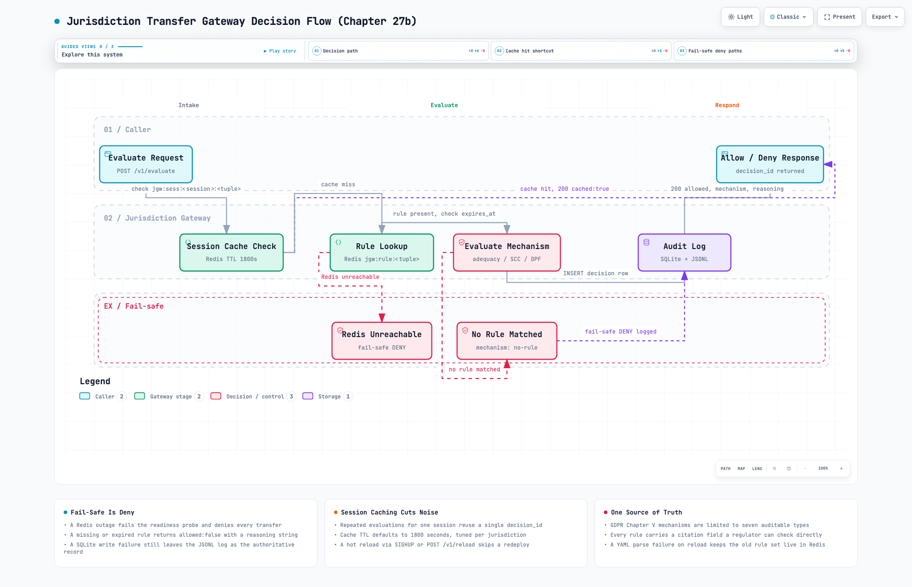

<div align="center">

<a href="../README.md"></a>

# Chapter 27b: The Jurisdiction Transfer Gateway and Cookie Consent

**📕 Part of Volume 4 — Compliance, Player Safety, Data Residency, and Governance** · €64.90

[The Backend of Luck](../README.md) · [Buy this volume on Amazon](https://www.amazon.com/dp/B0HBS473SJ) · [PDF and EPUB](https://leanpub.com/the-backend-of-luck) · [Chapter map](../README.md#chapter-map)

</div>

---

> Companion code for Chapter 27b of *The Backend of Luck*. The chapter itself
> explains the why and the trade-offs; the files here are what you run.
> Example operator throughout the series is the fictional **AcmeToCasino**.

---

> Decide, in real time, whether a cross-border data transfer is legally permitted — and log the decision for regulator evidence.

## Architecture diagram

<div align="center">
<a href="https://thebackendofluck.com/architecture/ch27b-jurisdiction-gateway-cookies.html"></a>

<sub><em>Jurisdiction Transfer Gateway Decision Flow. <a href="https://thebackendofluck.com/architecture/ch27b-jurisdiction-gateway-cookies.html">Open the interactive version</a>: pan, zoom, guided views, light/dark theme, export.</em></sub>
</div>


## Overview

The Jurisdiction Transfer Gateway (JGW) is a FastAPI microservice that evaluates every data transfer against a YAML rule set encoding GDPR Chapter V mechanisms (adequacy decisions, Standard Contractual Clauses, Data Privacy Framework, derogations, BCRs). It returns an allow/deny decision in O(1) via Redis-cached rules, and appends an immutable audit log entry to SQLite. The fail-safe is **deny**: if Redis is unreachable or a rule is missing, the transfer is blocked.

This is the running reference implementation discussed in Chapter 27b.

## Contents

| Path | Purpose |
|---|---|
| `app/main.py` | FastAPI application — rule loader, evaluator, audit logger, reload endpoint |
| `etc/rules.yaml` | Seed rule set — intra-EEA, UK adequacy, EU-US DPF, SCCs-2021, derogations |
| `k8s/deployment.yaml` | Kubernetes Deployment + Secret (ConfigMap-backed rules, admin token) |
| `k8s/namespace.yaml` | Dedicated `compliance` namespace |
| `k8s/redis.yaml` | Redis sidecar for O(1) rule evaluation |
| `systemd/jurisdiction-gateway.service` | Systemd unit for non-K8s deployments |
| `systemd/jgw-heartbeat.service` + `.timer` | 5-minute heartbeat check (systemd timer) |
| `scripts/jgw-heartbeat.sh` | Heartbeat probe script (curl + alert) |
| `tests/test_main.py` | Pytest suite — rule evaluation, audit log, reload, edge cases |
| `templates/dsr-ack-en.txt` | DSR acknowledgment template (English) |
| `templates/dsr-ack-pt.txt` | DSR acknowledgment template (Portuguese / LGPD) |
| `Dockerfile` | Multi-stage build (python:3.12-slim by digest, venv copied to the same base, non-root uid 10010) |
| `requirements.txt` | Python dependencies (FastAPI, Redis, PyYAML, uvicorn) |
| `policy-diff-fraud.md` | Policy analysis: fraud detection data flows across jurisdictions |

## Technology Stack

- **Runtime:** Python 3.12, FastAPI, uvicorn
- **Cache:** Redis (rule evaluation hot path)
- **Storage:** SQLite (append-only audit log; Postgres-portable schema)
- **Orchestration:** Kubernetes (K3s on ops-host) or systemd
- **Container:** python:3.12-slim pinned by digest, non-root

## Prerequisites

```bash
python3 -m venv .venv && source .venv/bin/activate
pip install -r requirements.txt
```

Redis must be reachable (default `localhost:6379`). Override via `REDIS_URL` env var.

## How to Run

```bash
# Local development
RULES_PATH=etc/rules.yaml uvicorn app.main:app --port 8400 --reload

# Test
pytest tests/ -v

# Docker
docker build -t jgw:latest .
docker run -p 8400:8400 -v $(pwd)/etc:/etc/jurisdiction-gateway:ro jgw:latest

# Kubernetes (K3s)
kubectl apply -f k8s/namespace.yaml
kubectl apply -f k8s/redis.yaml
kubectl apply -f k8s/deployment.yaml
```

## Security Notes

- `admin-token` in `k8s/deployment.yaml` is set to `"change-me-in-prod"` — replace with a real secret before deploying. In production, source from OpenBao or a Kubernetes Secret sealed with kubeseal.
- The audit log is append-only by design. Do not grant DELETE on the SQLite file to any non-root user.
- Rule YAML is versioned by SHA-256 hash; every reload logs the old and new hash for provenance.
- Fail-safe is **DENY** — a Redis outage blocks all transfers until recovery.
- `POST /v1/reload` needs `Authorization: Bearer <JGW_ADMIN_TOKEN>` and is denied (403) when no token is configured. The token is never read from the query string. A malformed rules file returns 422 and the old rules stay live; a successful reload also clears the session cache.
- `/v1/crypto/encrypt` and `/v1/crypto/decrypt` need their own bearer secrets (`JGW_CRYPTO_ENCRYPT_TOKEN`, `JGW_CRYPTO_DECRYPT_TOKEN`) and are denied when unset. Decrypt rejects anything that is not a `vault:` ciphertext instead of echoing it.
- TLS to OpenBao is verified against the CA file in `BAO_CACERT` (hostname checked). For a self-signed listener, point `BAO_CACERT` at that certificate; there is no switch to turn verification off.
- If the audit line cannot be written, `/v1/evaluate` answers 503 instead of releasing an unrecorded decision.

## Related

- See Chapter 27b in the book for the full legal analysis (Schrems II, DPF, SCCs, LGPD interplay).
- Chapter 24e (Geofencing & Location Verification) for the complementary location-based controls.
- Chapter 34b (Data Governance) for the broader data lifecycle this gateway plugs into.
- [The Backend of Luck →](https://thebackendofluck.com)
